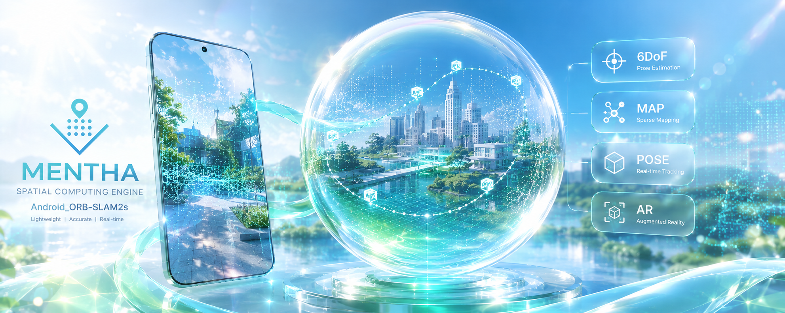
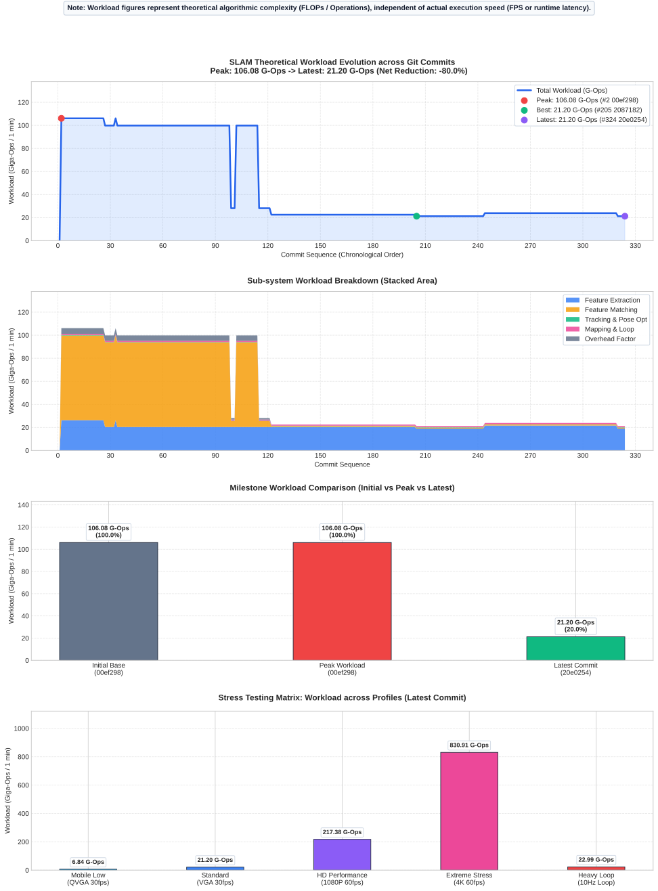

<div align="center">

[简体中文](README_zh.md) · [English](../README.md) · [Русский](README_ru.md) · [한국어](README_ko.md) · [日本語](README_ja.md)

</div>

---

<div align="center">

# 🌿 ハッカAR

**ほぼすべての Android スマートフォンに対応したビジュアル SLAM ソリューション**

</div>

---

> **一言でいうと**：ORB-SLAM2 をベースにした Android 向け拡張空間計算ツール。モバイルデバイスに安定した 6DoF 空間ポジショニングを提供します。

<p align="center">


</p>

---

## 🙏 謝辞

**【謹んで感謝】元の ORB-SLAM2 コア：**

https://github.com/raulmur/ORB_SLAM2

**【謹んで感謝】元の Android ORB-SLAM2 プロジェクト：**

https://github.com/Martin20150405/SLAM_AR_Android.git

---

# 🎯 ORB-SLAM2s: Android 空間コンピューティングと軽量 AR デモ

_ORB-SLAM2s の小文字の 's' は **Smart · Swift · Small**（スマート・迅速・小型）を意味し、元の ORB-SLAM2 と比較して強化された知能性、より高速なパフォーマンス、より軽量なサイズを強調しています。_

このプロジェクトでは小文字の 's' を使用しています。大文字の 'S' を持つ別の論文 ORB-SLAM2S：

```
(Y. Diao, R. Cen, F. Xue and X. Su, "ORB-SLAM2S: A Fast ORB-SLAM2 System
with Sparse Optical Flow Tracking," 2021 13th International Conference
on Advanced Computational Intelligence (ICACI), Wanzhou, China, 2021,
pp. 160-165, doi: 10.1109/ICACI52617.2021.9435915.)
```

は、このプロジェクトと同様の性能最適化のコンセプトを持っていますが、その手法はまだ統合されていません。しかし、この論文は今後の最適化方向性に対する貴重な参考資料となるでしょう。研究者の皆様の貢献と共有に心より感謝いたします。

---

## 📋 プロジェクト概要

**ORB-SLAM2s** は、ORB-SLAM2 をベースにした Android 向けの拡張空間コンピューティングツールです。リアルタイムのスパースポイントクラウドマッピング、マップの保存/読み込み、および再ローカライゼーションとマッチングをサポートしています。コンピュータビジョン、慣性航法（IMU）、拡張現実（AR）技術を組み合わせることで、モバイルデバイスに安定した **6DoF**（6自由度）の空間ポジショニングを提供します。

### 🤔 なぜ ORB-SLAM3 ではなく ORB-SLAM2 なのか？

- **軽量設計**：依存関係が少なくコードが簡素化されているため、モバイルプラットフォームでのコンパイルと展開が容易です。
- **IMU と VIO のサポートについて**：
  - **ORB-SLAM3 の高いハードル**：公式実装の VIO は**密結合（tightly coupled）**であり、高品質な IMU と厳密な**カメラ-IMU 間のタイムスタンプ同期**が必要です。これはロボット工学では一般的ですが、Android スマートフォンの標準 API では「すぐに使える」状態にするのは困難です。
  - **Android の現状**：既存の Android デバイスの多くはカメラと IMU の取得が非同期であり、統一されたハードウェア同期フレームワークに欠け、民生グレードの IMU はノイズやドリフトが大きくなります。厳密なキャリブレーションと同期がない場合、VIO は純粋な Visual SLAM よりも発散しやすくなります。SENSOR_TIMESTAMP メソッドは Android 11 以降のバージョンでのみ利用可能です。
- **低リソース消費**：ORB-SLAM3 と比較して CPU および RAM の要求が低いです。
- **実用的な効率**：単眼カメラのみのシナリオでは、標準的なモバイル用途において ORB-SLAM3 と同等のパフォーマンスを発揮します。

---

## ✨ 主要機能

- **🗺️ ポイントクラウド SLAM マッピング** —— 単眼カメラ入力に基づくリアルタイムのスパースマッピング
- **💾 マップの永続化** —— マップをローカルストレージに保存し、将来のセッションで再読み込み可能
- **🎯 再ローカライゼーションとマッチング** —— 既存マップの読み込み時の姿勢推定と特徴マッチング
- **📊 信頼度の可視化** —— キーポイントの追跡と、現在のフレームと読み込み済みマップ間のマッチング統計を可視化
- **📐 平面検出** —— 現在の姿勢とポイントクラウドデータに基づくインテリジェントな床/表面検出
- **🎨 ネイティブ AR レンダリング** —— **cgltf** と OpenGL ES による高性能 3D レンダリング。大容量の GLB/glTF モデルを高速に読み込み、検出した平面への配置とインタラクションをサポート
- **🌑 暗所フレーム検出** —— 暗いまたは低品質のフレームを自動的にスキップし、SLAM スレッドのブロッキングを防止
- **🖱️ AR オブジェクト管理** —— 3D オブジェクトの配置、ピンチジェスチャーによる拡大縮小などのインタラクションをサポートし、マルチマップのアンカーライフサイクルを維持
- **🧭 3DOF 姿勢追跡** —— デバイス内蔵センサーによる 3 自由度の方向追跡。多段フォールバック（回転ベクトル / ゲーム回転ベクトル / 加速度計 + 磁力計 / ジャイロ積分）に対応し、単眼トラッキングの一時的な喪失や急な旋回時にスムーズに姿勢を補正
- **📑 マルチマップ対応** —— 複数のマップファイルの同時読み込みとマッチングをサポート
- **🖥️ クロスプラットフォーム対応** —— Windows、macOS、Linux（龍芯 LoongArch64 を含む）、PlayStation Vita などのプラットフォーム向けに、独立したデスクトップ/組み込み実行とオフライン評価機能を提供

---

## ⚡ パフォーマンス指標

現在主に Qualcomm Snapdragon プラットフォーム CPU でテストしています：

| SoC                     | デバイス                | パフォーマンス |
| ----------------------- | ----------------------- | -------------- |
| Snapdragon 8 Elite      | Xiaomi 15               | 30 FPS         |
| Snapdragon 8 Gen 3      | Redmi K80               | 30 FPS         |
| Snapdragon 8+ Gen1      | Redmi K60               | 30 FPS         |
| Snapdragon 870          | Xiaomi 10S              | 30 FPS         |
| Snapdragon 7s Gen 2     | Redmi Pad Pro           | 30 FPS         |
| Snapdragon 6s Gen 2     | Redmi Pad 2 SE 4G       | 30 FPS         |
| Snapdragon 765G 5G      | vivo iQOO Z1x           | 30 FPS         |
| Snapdragon 835          | Xiaomi 6                | 20-30 FPS      |
| Snapdragon AR1 Gen 1    | Rokid Glass3            | 30 FPS         |
| MediaTek Dimensity 6300 | Lenovo Xiaoxin Pad 11   | 20-30 FPS      |

### 🌑 暗所フレーム検出

スムーズなユーザーエクスペリエンスを確保するために、システムは露出レベルを監視します。環境が暗すぎる場合、SLAM 追跡は一時停止され、計算遅延や「ロスト」状態を回避します。

---

## ✅ 進捗トラッカー

- [x] スパースポイントクラウド SLAM マッピング
- [x] マップ保存 / 読み込み機能
- [x] 再ローカライゼーションマッチング
- [x] ネイティブ AR レンダリングエンジン
- [x] 暗所フレームスキップロジック
- [x] 3D AR オブジェクト管理とマルチマップアンカーのライフサイクル維持
- [x] 複数マップファイルの同時読み込みとマッチング
- [x] 3DoF 融合センサー補助追跡
- [x] クロスプラットフォームスタンドアロン実行とベンチマーク（Windows / macOS / Linux / 龍芯 / PS Vita 等）

## 🗺️ 今後のロードマップ

- [ ] マッピング速度と初期化の改善
- [ ] AR の安定性と 6DoF の堅牢性の強化
- [ ] より高いフレームレートのためのレンダリングパイプラインの最適化
- [ ] センサーフュージョンの深化（VIO —— Visual Inertial Odometry）
- [ ] SLAM 周波数のダウンサンプリングと適応ノイズ処理
- [ ] 精密なセンサーチェッキングロジック
- [ ] **Unity3D** との統合

---

## 📦 ソースコードを取得

```
git clone --recursive https://github.com/Olsc/Android_ORB-SLAM2s.git
```

## 💝 謝辞

このプロジェクトは、以下の優れたオープンソースライブラリに基づいて構築されています：

- [ORB-SLAM2](https://github.com/raulmur/ORB_SLAM2)
- [DBoW2](https://github.com/dorian3d/DBoW2)
- [g2o](https://github.com/RainerKuemmerle/g2o)
- [Eigen](http://eigen.tuxfamily.org/)
- [OpenCV](https://opencv.org/)

---

# 📚 ORB-SLAM2

**著者：** [Raul Mur-Artal](http://webdiis.unizar.es/~raulmur/)、[Juan D. Tardos](http://webdiis.unizar.es/~jdtardos/)、[J. M. M. Montiel](http://webdiis.unizar.es/~josemari/) および [Dorian Galvez-Lopez](http://doriangalvez.com/) ([DBoW2](https://github.com/dorian3d/DBoW2))

ORB-SLAM2 は、**単眼**、**ステレオ**、および **RGB-D** カメラ用のリアルタイム SLAM ライブラリであり、カメラの軌跡とスパース 3D 再構成（ステレオおよび RGB-D では真のスケールで）を計算します。ループを検出し、リアルタイムでカメラを再ローカライズできます。

<a href="https://www.youtube.com/embed/ufvPS5wJAx0" target="_blank"></a>
<a href="https://www.youtube.com/embed/T-9PYCKhDLM" target="_blank"></a>
<a href="https://www.youtube.com/embed/kPwy8yA4CKM" target="_blank"></a>

### 📖 関連出版物

**[単眼]** Raúl Mur-Artal, J. M. M. Montiel and Juan D. Tardós. **ORB-SLAM: A Versatile and Accurate Monocular SLAM System**. _IEEE Transactions on Robotics,_ vol. 31, no. 5, pp. 1147–1163, 2015. (**2015 IEEE Transactions on Robotics Best Paper Award**). **[PDF](http://webdiis.unizar.es/~raulmur/MurMontielTardosTRO15.pdf)**

**[ステレオおよび RGB-D]** Raúl Mur-Artal and Juan D. Tardós. **ORB-SLAM2: an Open-Source SLAM System for Monocular, Stereo and RGB-D Cameras**. _IEEE Transactions on Robotics,_ vol. 33, no. 5, pp. 1255–1262, 2017. **[PDF](https://128.84.21.199/pdf/1610.06475.pdf)**

**[DBoW2 Place Recognizer]** Dorian Gálvez-López and Juan D. Tardós. **Bags of Binary Words for Fast Place Recognition in Image Sequences**. _IEEE Transactions on Robotics,_ vol. 28, no. 5, pp. 1188–1197, 2012. **[PDF](http://doriangalvez.com/php/dl.php?dlp=GalvezTRO12.pdf)**

---

# 📜 ライセンス

## ORB-SLAM2 コアライブラリ

ORB-SLAM2 コアライブラリは [GPLv3 ライセンス](https://github.com/raulmur/ORB_SLAM2/blob/master/LICENSE.txt)の下でリリースされています。すべてのコード/ライブラリ依存関係（および関連ライセンス）のリストについては、[Dependencies.md](https://github.com/raulmur/ORB_SLAM2/blob/master/Dependencies.md) を参照してください。

商用目的での非オープンソース版 ORB-SLAM2 については、著者に連絡してください：orbslam (at) unizar (dot) es。

## このプロジェクト (ORB-SLAM2s)

本プロジェクトは、Android IPC プロセス分離に基づくマルチモジュール・ライセンスアーキテクチャを採用しています：

- **`app/` モジュール**: **[Apache License 2.0](https://github.com/Olsc/Android_ORB-SLAM2s/blob/main/app/LICENSE)** (Apache-2.0) の下でライセンスされています。UI、カメラプレビュー、ネイティブ cgltf/OpenGL ES 3D レンダリング、センサーコンポーネントが含まれます。
- **`MenthaAR/` エンジンモジュール**: ORB-SLAM2 から派生し、**[GNU General Public License v3.0](https://github.com/Olsc/Android_ORB-SLAM2s/blob/main/MenthaAR/LICENSE)** (GPLv3) の下でライセンスされています。C++ SLAM コアアルゴリズムとネイティブ処理が含まれます。
- **IPC プロセス分離通信**: `app` モジュールと `MenthaAR` エンジンは独立した Android OS プロセスで実行され、Binder IPC および共有メモリ（Ashmem/memfd）を介して通信することで、それぞれのライセンス境界を維持しています。

詳細については、[LICENSE](../LICENSE)、[app/LICENSE](../app/LICENSE)、および [MenthaAR/LICENSE](../MenthaAR/LICENSE) を参照してください。

プロジェクトコラボレーションまたはその他の分野の協力に関するお問い合わせは、**OlscStudio@outlook.com** までご連絡ください。

## サードパーティの依存関係とライセンス

このプロジェクトは、いくつかの優れたオープンソースのサードパーティライブラリに依存しています。各々のオープンソースライセンスを厳格に遵守しています：

- **[OpenCV](https://github.com/opencv/opencv)** —— **Apache 2.0 ライセンス**
- **[srrg_hbst](https://gitlab.com/srrg-software/srrg_hbst)** —— **BSD 3-Clause ライセンス**。高速でスケーラブルな画像マッチングに使用されます。
- **[DBoW2](https://github.com/dorian3d/DBoW2)** —— **BSD ライセンス**。基本的な語彙ベクトルおよび特徴マッチング構造に使用されます。
- **[g2o](https://github.com/RainerKuemmerle/g2o)** —— **BSD ライセンス**（コアコンポーネント）。非線形最適化に使用されます。
- **[Eigen3](http://eigen.tuxfamily.org/)** —— **MPL2 (Mozilla Public License v2.0)**。行列演算および代数計算に使用されます。
- **[cgltf](https://github.com/jkuhlmann/cgltf)** —— **MIT ライセンス**。app モジュールで 3D モデルをネイティブかつ高速に読み込むためのシングルファイル C 言語 glTF 2.0 / GLB パーサー。

サードパーティライセンスに関する問題については、それぞれの公式リポジトリを参照してください。

### 📝 学術的引用

学術的研究で ORB-SLAM2（単眼）を使用する場合は、以下のように引用してください：

```bibtex
@article{murTRO2015,
  title={{ORB-SLAM}: a Versatile and Accurate Monocular {SLAM} System},
  author={Mur-Artal, Ra\'ul, Montiel, J. M. M. and Tard\'os, Juan D.},
  journal={IEEE Transactions on Robotics},
  volume={31},
  number={5},
  pages={1147--1163},
  doi = {10.1109/TRO.2015.2463671},
  year={2015}
}
```

学術的研究で ORB-SLAM2（ステレオまたは RGB-D）を使用する場合は、以下のように引用してください：

```bibtex
@article{murORB2,
  title={{ORB-SLAM2}: an Open-Source {SLAM} System for Monocular,
          Stereo and {RGB-D} Cameras},
  author={Mur-Artal, Ra\'ul and Tard\'os, Juan D.},
  journal={IEEE Transactions on Robotics},
  volume={33},
  number={5},
  pages={1255--1262},
  doi = {10.1109/TRO.2017.2705103},
  year={2017}
}
```

この Android アダプテーション（ORB-SLAM2s）を学術的研究で使用する場合は、適切にこのオープンソース URL を記載してください。

---

# ⚙️ 事前条件

## OpenCV

画像と特徴の操作には [OpenCV](http://opencv.org) を使用しています。

## HBST（Hierarchical Bag of Scalable Trees）

高速でスケーラブルな画像マッチングのために [srrg_hbst](https://gitlab.com/srrg-software/srrg_hbst) を統合しました。従来の DBoW2 と比較して、ループ検出とリローカリゼーションのパフォーマンスが大幅に向上しています。

## Eigen3

g2o に必要です（下記参照）。ダウンロードおよびインストール手順は以下にあります：http://eigen.tuxfamily.org。

## DBoW2 および g2o（Thirdparty フォルダに含まれています）

[DBoW2](https://github.com/dorian3d/DBoW2) および [g2o](https://github.com/RainerKuemmerle/g2o) ライブラリをアルゴリズム参照として使用しています。両方のライブラリ（ライセンスを含む）は _Thirdparty_ フォルダに含まれています。

---

# 💻 クロスプラットフォーム対応 (Desktop & Embedded)

Android 端末に加え、本プロジェクトでは `MenthaAR/src/main/cpp/Thirdparty_Platforms/` にデスクトップおよび携帯ゲーム機向けプラットフォームのスタンドアロン SLAM 実装とオフラインベンチマークツールを提供しており、同一のコア SLAM アルゴリズムを共有しています：

| プラットフォーム | ディレクトリ | 説明 |
| :--- | :--- | :--- |
| **Windows** | [`windows/`](../MenthaAR/src/main/cpp/Thirdparty_Platforms/windows/Readme.md) | MSVC/MinGW をサポートし、AVX2 SIMD 命令セットを有効化。リアルタイムカメラ SLAM およびオフライン動画ベンチマークに対応 |
| **Ubuntu / Linux** | [`ubuntu/`](../MenthaAR/src/main/cpp/Thirdparty_Platforms/ubuntu/Readme.md) | x86_64、aarch64 および中国産 **LoongArch64**（龍芯）アーキテクチャをサポート |
| **macOS** | [`mac/`](../MenthaAR/src/main/cpp/Thirdparty_Platforms/mac/Readme.md) | Apple Silicon (arm64, NEON) と Intel (x86_64, AVX2) にネイティブ対応し、AVFoundation と Cocoa GUI を統合 |
| **PlayStation Vita** | [`psvita/`](../MenthaAR/src/main/cpp/Thirdparty_Platforms/psvita/Readme.md) | VitaSDK による携帯ゲーム機向け実験的単眼 SLAM。前後カメラのリアルタイム追跡、ポイントクラウド描画、バイナリマップ保存に対応 |

---

# 🧭 慣性航法（IMU）とセンサーフュージョンについて

参考研究プロジェクト：https://github.com/Olsc/Android_3dof

上記研究に基づき、本プロジェクトでは内蔵センサーによる 3DoF 姿勢推定およびセンサー補助トラッキングを統合しました：
- **多段階センサーフォールバック戦略**：`TYPE_ROTATION_VECTOR` を優先し、地磁気センサー非搭載端末では `TYPE_GAME_ROTATION_VECTOR` へ自動フォールバック。複合センサーが不足している場合でも加速度計＋磁気計またはジャイロスコープの時間積分と相補フィルターにより姿勢演算を行い、あらゆる Android 端末での動作を担保します。
- **SLAM 姿勢補償**：急激なカメラ回転や遮蔽によって単眼ビジュアルトラッキングが一時的にロストした際、センサーの方向変化を利用して姿勢をデッドレコニング（推測航法）で補完・平滑化し、AR 表示の安定性を高めます。
- **今後の展望**：ハードウェアタイムスタンプ同期を伴う密結合ビジュアル慣性オドメトリ（VIO）は引き続き研究開発を進めています。

---

# 🧮 理論的計算複雑度



---

# 🐳 マスコット

<div align="center">


_キャラクター：ハッカ_

</div>

---

<br>

# ♥ 貢献者

[](https://github.com/Olsc/Android_ORB-SLAM2s/graphs/contributors)
